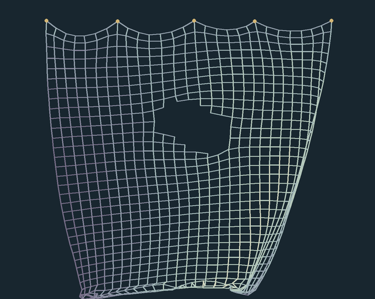

# Tension Study

[Open the interactive worksheet to check a prediction or read its explanation.](README.html)

Cut a hanging fabric swatch and watch the load redistribute around the opening. Each vertex has a three-dimensional position and up to eight distance constraints. Warp, weft and diagonal shear constraints all participate in the solver. The window draws the warp and weft strands. This model represents cloth at the mesh scale. The optional tensile threshold models brittle link failure. Yarn-scale damage, fiber friction and self-collision are topics for a higher-fidelity model.



## Open the lab

Use the same Python interpreter and NVIDIA NVRTC setup as the [swarm lab](../render/README.md). From this directory run the checks, then open the desktop scene.

```powershell
python knit.py --check
python knit.py
```

`python knit.py --cpu-check` runs the scalar manufactured cases when the GPU is unavailable. No extra Python packages are required. The CUDA step keeps position buffers and topology on the GPU. Drawing reads the current positions back into a Tk canvas.

| Input | Effect |
|---|---|
| Drag left mouse | Cut all warp, weft and diagonal constraints crossed by the brush |
| Drag right mouse | Grab the nearest free vertex and hold it at the pointer. Release to let the swatch relax. |
| 1 / 2 / 3 | Switch between exhaustive, gathered, and learner CUDA kernels |
| Space / N | Freeze the current state / reset the swatch |
| [ / ] | Decrease / increase constraint sweeps per fixed simulation step |
| T | Toggle tension-triggered tearing while the simulation runs. The default threshold is 35% extension. |
| D | Color visible edges by absolute relative strain |
| R | Compile the saved `student.cuh` and select Student |

## First session · What changed in the material? (45–60 minutes)

Week 6, Day 1 uses the pinned edge and the free interior to study how a pull changes strain. Return to the lesson for the two-point check. Brush cuts and permanent damage are the subject of Day 4.

1. Let the scene hang for a few seconds. Right-drag a free vertex near the middle and hold it. Press D to watch the strain spread, then release and watch the swatch relax. Press Space. Point to two places that carry a high load. The five gold pins fix translation at those vertices. How do they affect the load path? [Check or explain](README.html#check-cloth-pins).
2. Drag across the middle while paused. Some strands disappear immediately. Record the cut count, simulation time and RMS strain. Resume for a few steps and freeze. Explain the immediate effect of deleting edges and the later motion of surviving nodes.
3. Reset and cut near a free edge. Sketch which remaining constraints keep the patch together. Diagonals are hidden from the wireframe and still carry load until the brush severs them. A different color mode changes the display. A cut changes the equations for the next integration step. [Check or explain](README.html#check-cloth-edge).
4. Read the distance-constraint section in Müller et al. Two endpoints lie on a line, with the left endpoint at 0 and the right endpoint at 1.2. The edge has rest length 1. Draw the positions after a correction that restores its rest length. First let two equal-mass endpoints share the correction equally. Then pin the left endpoint and repeat. Which way does each moving endpoint go? [Position Based Dynamics paper](https://matthias-research.github.io/pages/publications/posBasedDyn.pdf) [Check or explain](README.html#check-cloth-correct).

   <details><summary>Compare the endpoint positions</summary><p>With equal masses the endpoints move toward one another by 0.1 each, to 0.1 and 1.1. With the left endpoint pinned at 0, the right endpoint moves the full 0.2 to reach 1.</p></details>

### Pull until it rips

1. Press N to reset, D for the strain view if needed, and T to enable tension-triggered tearing. Watch for `tear >35%` in the HUD. Right-drag a free vertex quickly while the simulation runs. The CUDA kernel checks each active link after position prediction and before the constraint sweeps. Its edge thread permanently clears the active byte when `length > rest × 1.35`. Release the mouse and inspect the resulting hole. A link under compression stays intact.
2. Try a fresh run with `python knit.py --tear-strain 0.15`, then 0.60. Predict which cloth survives a larger stretch. Changing the threshold changes the material model. For a solver-speed comparison, hold the threshold fixed and verify that the exact same edges broke. [Check or explain](README.html#check-cloth-threshold).
3. Three links of rest length 2 reach lengths 1.0, 3.0, and 3.1. At a tear threshold of 0.50, a link breaks if its extension exceeds half its rest length. Decide which links break and explain what happens on an exact tie. The HUD averages strain over surviving links. Why might that reading fall just after a tear? [Check or explain](README.html#check-cloth-tie).

   <details><summary>Compare the three links</summary><p>The breaking length must be greater than 3.0. The compressed link and the link at exactly 3.0 survive. The link at 3.1 breaks. Removing a highly stretched link can lower the average strain among the links still present.</p></details>
4. Run `python knit.py --check` to verify a threshold tie, compression, an overloaded edge, and persistent damage after release. Then try `python knit.py --bench --tear-strain 0.01 --frames 9`. At this intentionally fragile setting, even the initial corrugation breaks some links. The CSV compares final positions and topology across all three algorithms and includes the fracture pass in GPU step time. The main speed exercise below uses fracture disabled.

## Second session · Turn a dense search into a local gather (60–120 minutes)

On Week 6, Day 2, follow one vertex from the old positions to its single output in the first paragraph. Return to the lesson for the intact-patch checks. Day 3 uses the eight incident slots below to implement and time the student gather.

Each step runs the Verlet-style prediction in `cloth.cu`, then a fixed number of Jacobi projection sweeps. During one sweep, each vertex reads the previous sweep's positions, accumulates its share of each incident active constraint, averages the corrections, and writes one output. Swapping input and output buffers makes updates visible at the next sweep boundary. Constraint averaging follows the parallel Jacobi approach discussed by Macklin et al. [Unified Particle Physics for Real-Time Applications](https://matthias-research.github.io/pages/publications/flex.pdf)

1. Read the Student loop in `student.cuh`. For a grid of 28 columns and 34 rows, the lab allocates 952 vertices and 3,624 structural/shear edges. Bound the number of edge inspections per sweep as `V × E`. Explain how fixed vertices reduce the actual count slightly. [Check or explain](README.html#check-cloth-scan).
2. Draw a small intact patch with horizontal and vertical links and both diagonals in every square. A vertex’s degree is the number of links that touch it. Count the degree of an interior vertex, a boundary vertex away from the corners, and a corner. Compare those counts with the edge IDs in `Mesh.incident` in `physics.py`. The GPU stores each vertex’s list in an eight-slot row. A negative edge ID marks an unused slot. [Check or explain](README.html#check-cloth-degree).

   <details><summary>Compare the three degrees</summary><p>An interior vertex touches four horizontal or vertical neighbors and four diagonal neighbors, for a degree of 8. At a straight boundary it touches three horizontal or vertical neighbors and two diagonal neighbors, for 5. A corner touches two horizontal or vertical neighbors and one diagonal neighbor, for 3.</p></details>
3. Change Student to inspect the current vertex's eight slots. Skip negative entries and inactive edges. Keep the original accumulation order and preserve the pin and zero-length cases. Press R and run `python knit.py --check`. Inspect the reference `gathered` kernel after attempting your own edit.
4. Relate this to matrix algorithms. Draw the sparse edge–vertex incidence matrix. The baseline effectively searches its full edge dimension for every vertex. The gathered solver stores just its nonzeros by vertex. Explain the storage tradeoff of keeping eight slots even at the boundary. Would this shape still suit an irregular triangle mesh? [Check or explain](README.html#check-cloth-storage).
5. Benchmark on one grid, then increase both dimensions. Use the command below for identical initial positions, timestep, solver iterations and sampled states across all three modes. Each mode advances a separate state. The program rotates execution order, discards five warm-up steps, validates the final positions against the baseline within `1e-5` world units, and prints median/p95 GPU step times.

```powershell
python knit.py --bench --cols 28 --rows 34 --iterations 6 --frames 41
python knit.py --bench --cols 48 --rows 48 --iterations 6 --frames 41
```

In a 41-sample run on an RTX 3070 at the smaller size, the baseline took **2.389 ms** median per GPU step. Gathered took **0.043 ms** with zero final position difference. Step timing covers prediction plus six projection launches and the intervals between them. Window FPS also includes host transfer, strain calculation, Tk drawing and timer pacing. While frozen, the HUD reports GPU idle because it is displaying the same geometry. Compare your 5070 measurements using both distributions.

## Third session · Speed versus physical error (60–90 minutes)

1. `--check` perturbs a central vertex, applies six sweeps with no external forces, and measures **RMS fractional strain** using `sqrt(mean((length / rest − 1)²))` over live edges. The intact manufactured case decreases from about 0.103 to 0.031. The test fills destination buffers with NaN before each checked sweep, so accidentally skipping a pin or tail store produces a failure. The suite also checks partial cuts, an isolated vertex, pinned positions, partial CUDA blocks and agreement against a scalar CPU implementation.
2. Predict how a smaller timestep and additional sweeps affect stretch. Compare the following runs at the same **one second of simulated time**. Five warm-up steps also advance simulation state, so 55 measured steps at 1/60 s and 115 measured steps at 1/120 s both end at one simulated second. Double the gathered median step time in the second run when comparing work per 1/60 s of simulated time. [Check or explain](README.html#check-cloth-step).

```powershell
python knit.py --bench --dt 0.0166666667 --iterations 6 --frames 55
python knit.py --bench --dt 0.0083333333 --iterations 6 --frames 115
python knit.py --bench --dt 0.0166666667 --iterations 12 --frames 55
```

3. Record both RMS strain and compute cost. Decide whether a reduction in sweeps improved the algorithm or changed the simulated material's response. The damping factor is applied once per integration step. Halving the timestep also applies damping twice as often per simulated second. For a controlled follow-up, derive a step-sized damping factor `d(dt) = d_ref ** (dt / dt_ref)` and repeat. [Check or explain](README.html#check-cloth-damp).
4. For your lab report, explain why in-place parallel updates would invalidate this Jacobi comparison, why severed diagonal constraints matter to a visible slit, and when scaling would make the Tk drawing path dominate the GPU step. For an extension, explore compliance using the authors' XPBD formulation and compare effective stiffness across timesteps. [XPBD paper](https://matthias-research.github.io/pages/publications/XPBD.pdf)
