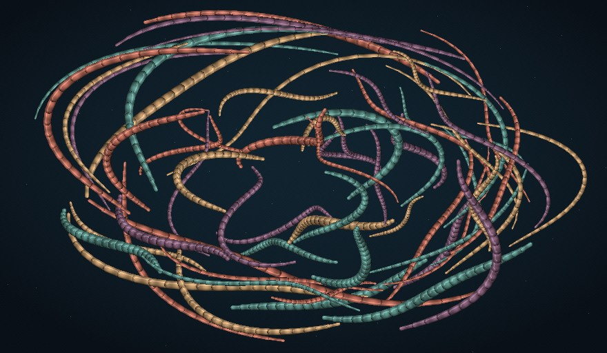

# Abyssal Swarm

[Open the interactive worksheet to check a prediction or read its explanation.](README.html)

An animated colony contains up to 256 organisms, each made of 24 overlapping line segments with round ends. A CUDA thread shades each pixel. Your job is to preserve which segment covers each pixel while reducing the amount of work needed to find it.



## Start here

From this directory, use a 64-bit Python interpreter with Tk, an NVIDIA driver and NVRTC 11.2 or newer. The first command exercises real CUDA kernels on six scenes. The second opens the live viewport.

```powershell
python swarm.py --check
python swarm.py
```

On the development machine, Anaconda Python discovered an existing NVRTC in its PyTorch installation. The lab can also find a CUDA Toolkit under `CUDA_PATH` (including a toolkit on G:), an NVIDIA Python NVRTC package, or a compiler on `PATH`. An explicit `CUDA_LAB_NVRTC` environment variable selects a compiler DLL by full path. NVRTC needs its matching built-ins library alongside it. The window title and terminal report the selected GPU and PTX target. On the RTX 5070, an up-to-date compiler can target compute_120. An older supported compiler can use an earlier PTX target and let the driver compile it for the GPU. This lab uses scalar CUDA cores. [NVIDIA NVRTC guide](https://docs.nvidia.com/cuda/nvrtc/index.html) · [NVIDIA GPU compute capabilities](https://developer.nvidia.com/cuda/gpus)

Before CUDA is available, `python swarm.py --cpu --check` exercises the independent geometry oracle and `python swarm.py --cpu` opens a smaller live CPU scene. The CPU painter visits each capsule's screen-space bounds. CUDA mode switching and NVRTC hot reload require the GPU path. All assets are procedural. This lab defaults to disabling the CUDA driver's disk compilation cache for its own process.

| Control | Action |
|---|---|
| 1, 2, 3 | Exhaustive baseline, tiled reference, editable student kernel |
| Space | Freeze or resume the simulation clock. Timing continues on the same geometry. |
| Click | Move the colony center. Place it near a corner to test clipping. |
| + and − | Add or remove eight worms |
| D | Cycle beauty, encoded segment IDs and candidate-work heatmap. CPU preview has beauty and IDs. |
| V | Freeze this frame, compare CUDA colors and winner IDs byte for byte across variants, and check the device winners against the CPU painter |
| R | Recompile from disk and switch to Student. Compiler errors point into the editable file. |
| H / Esc | Hide controls / close |

## Lab 1 · Establish a baseline (45–60 minutes)

In Week 1, Day 3, read the timing definitions and use the lesson’s commands to compare kernel time with host time. In Week 4, Day 1, freeze the frame and inspect the candidate heatmap. On Day 5, use those timing definitions again for your matched sparse and crowded scenes.

1. Run `python swarm.py --width 768 --height 448 --worms 56`. Press Space to freeze the frame and 1 to select the exhaustive baseline. Every pixel tests every segment, and each worm has 24 segments. Predict how many times the baseline calls `testSegment` across the entire frame. Write down which factors count pixels and which count segments. [Check or explain](README.html#check-swarm-calls).

   <details><summary>Check the number of segment tests</summary><p>There are 768 × 448 = 344,064 pixels and 56 × 24 = 1,344 segments. The exhaustive pass makes 344,064 × 1,344 = 462,422,016 calls per frame.</p></details>
2. Press D twice to display the candidate heatmap. Brightness shows what fraction of all segments a pixel sends to the hit test. Before switching modes, predict whether the exhaustive baseline will show bright and dark patches on the same frame. Switch to 2 and describe where the bright tiles are. Predict what happens when you move the colony partly offscreen, then try it. [Check or explain](README.html#check-swarm-bright).

   <details><summary>Compare the two heatmaps</summary><p>The exhaustive baseline tests every segment at every pixel, so its brightness is uniform. Mode 2 shares a candidate list across each tile. Tiles overlapping many capsule bounds can appear brighter than tiles that miss most of the colony.</p></details>
3. Press D to return to beauty, then V. A correct optimized solver chooses the same winner everywhere. If several capsules overlap, the largest original segment index wins. Explain how that rule makes the final image independent of insertion order.
4. Run the benchmark below. On the frozen workload it checks both the RGB frame and the winning segment ID at every pixel. Different segments can shade to the same color. It then times the beauty pass, rotating mode order and discarding five warm-up samples per mode. Record the median and p95 from at least 30 measured samples. `kernel_*` times CUDA events around the single render launch. `host_*` times geometry packing, upload, launch, synchronization, pixel readback and host buffer creation. The live FPS includes animation, GUI transfer and presentation. The benchmark first fills each output with a color absent from the reference palette. A kernel that skips stores will fail this preflight even when the previous variant rendered the expected frame. [CUDA event timing](https://docs.nvidia.com/cuda/cuda-driver-api/group__CUDA__EVENT.html)

```powershell
python swarm.py --bench --width 768 --height 448 --worms 56 --frames 41
```

For your RTX 5070 run, record the PTX target and the baseline and tiled kernel and host medians. Divide each baseline median by the corresponding tiled median. Which speedup would you quote for the whole frame measured by the benchmark? Estimate how much host time would remain if the render launch took almost no time and other costs stayed fixed. Explain why this estimate alone cannot predict the live window’s FPS. [Check or explain](README.html#check-swarm-time).

<details><summary>Compare with one measured RTX 3070 run</summary><p>At the same scene size, median kernel time fell from 2.248 ms to 0.040 ms (about 56×). Host time fell from 3.624 ms to 1.278 ms (about 2.8×). Subtracting the tiled kernel median from the tiled host median gives a rough 1.24 ms for the rest of this benchmark. These separately measured medians give an estimate. The live window also presents the frame.</p></details>

## Lab 2 · Make your own first cut (60–90 minutes)

Week 4, Day 2 uses the bounding-box example to understand which candidates reach the exact hit test. Return to the lesson for the overlapping-tip check. Day 3 is the CUDA edit. Front-to-back traversal below is a separate optimization.

Edit `student.cuh`. Leave the baseline as an oracle. Use a frozen frame with 3 selected for comparisons.

1. **Bounding box rejection.** Every point of a radius-`r` capsule lies inside the endpoint bounds expanded by `r`. Use `overlaps` with left=right=`x+0.5` and top=bottom=`y+0.5`. Increment `tested` only for candidates passed on to `testSegment`. Predict whether fewer distance calculations will pay for the extra bounds reads. [Check or explain](README.html#check-swarm-box).
2. Save, press R, then V. Benchmark 8, 56, and 120 worms. Record a row with scene size, hypothesis, kernel p50/p95, host p50, and image-check result for each run. The work view maps the square root of the **fraction of candidates passed to the hit routine** to brightness. It does not count bounding-box tests or floating-point instructions.
3. **Front-to-back exit.** Traverse in descending segment ID and exit after the first covering capsule. Which invariant makes that legal? Predict the difference for an empty pixel and for a pixel under ten overlapping capsules. Test each prediction with the heatmap. Keep your change if the benchmark supports it. [Check or explain](README.html#check-swarm-exit).
4. Deliberately shrink the expanded box by a pixel, freeze, and press V. Inspect the first disagreement coordinate. Restore the expansion and re-run `--check`. This demonstrates the cost of a false negative. False positives cost work while passing exact tests.

**A rounding experiment.** The last case in `--check` tests a point-capsule of radius 1 centered at (−0.5, 0.50001). At pixel center (0.5, 0.5), the squared distance is approximately 1 + 10⁻¹⁰. FP32 rounds that distance to 1. On this device the pixel lands on the included rim, while the CPU’s double-precision test puts it just outside. The check reports any cross-precision disagreement within a narrow, coordinate-scaled silhouette band. Every CUDA variant must still agree on every ID and RGB byte exactly. Change the radius to 0.99 on paper and predict both decisions. [Check or explain](README.html#check-swarm-round).

**Retrieval check.** Explain why a partly offscreen capsule can still hit an onscreen pixel. Draw an endpoint at `x = -1` and a radius of three.

## Lab 3 · Share work across a tile (90–150 minutes)

A block covers 16 × 16 pixels. Let `P` be total pixels, `T` total blocks, `S` total capsules and `k_t` the surviving candidates of tile `t`. The exhaustive loop examines `P × S` pixel/segment pairs. A blocked algorithm can spend `T × S` cheap bounds tests followed by at most `sum(pixels_in_tile × k_t)` expensive hit calls. Bound both expressions in the worst case, then consider a largely empty screen. [NVIDIA GPU Gems chapter on conservative broad-phase culling](https://developer.nvidia.com/gpugems/gpugems3/part-v-physics-simulation/chapter-32-broad-phase-collision-detection-cuda)

1. In Student, compute the rectangle containing the **centers** of all pixels in a block. Check the capsule bounds against this rectangle. First have each thread do its own filtering. Validate the output. Which inputs repeat across the 256 lanes? [Check or explain](README.html#check-swarm-share).
2. Work in batches of 128 segments. Give each of the first 128 lanes one bounds test. Reserve a shared slot by incrementing a shared counter atomically, then write the original segment ID and geometry into that slot. Draw a three-step timeline showing where resets, producer writes and reader completion need a block-wide barrier.
3. Remove the early return for edge threads before introducing block barriers. Use an `activePixel` flag around hit tests and final stores. All threads must participate in every barrier. Make the width 769 and the height 449 to expose partial blocks.
4. Press R, V and run `--check`. If the screen flickers, ask whether the winner is chosen by original ID or by insertion order. If a tail batch fails, check the global `id < count` predicate. Open the worked `tiled` kernel in `kernels.cu` after you have a passing implementation or a specific failure to diagnose.
5. Benchmark the original and optimized calculations on the same frozen scene. Find one setting where a large drop in kernel time barely affects live FPS. Explain the next bottleneck using bytes transferred per frame or samples from a profiler. A 768 × 448 RGB image alone is 1,032,192 bytes per readback. [NVIDIA CUDA Best Practices Guide](https://docs.nvidia.com/cuda/cuda-c-best-practices-guide/index.html)

## Challenge · Design a useful failure (half a day)

Week 4, Day 4 asks for one crowded case and an explanation of its cost. Keep that result for Day 5’s comparison. Building an alternative spatial index is an optional project.

Find a distribution for which culling pays poorly. Try making every capsule nearly fill the viewport in `scene.py`, or create many capsules on the same thin path. Compare work heatmaps, kernel times and verification results. Then design an alternate index such as per-tile lists built once for a static scene. Include index construction, transfer costs and the number of frames needed to amortize the index. Show one attractive scene, one hostile scene, and one explanation of why their rankings differ. [Check or explain](README.html#check-new-shape).

**Next-day recall.** Without the code, sketch how adjacent pixels share a candidate list, what makes the list conservative, what defines a tie, and which timing excludes the framebuffer transfer. Check your sketch against `kernels.cu`. Export a reproducible fixed frame with `python swarm.py --snapshot frame.ppm`; `--width`, `--height`, `--worms`, `--mode`, and `--view` also apply.
